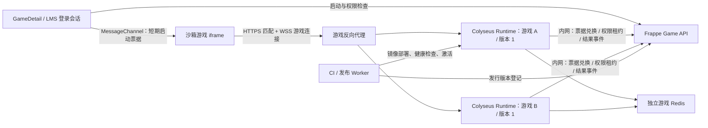

# Game 接入 Colyseus 联机服务方案

> 已被 [通用 Room 重构计划](game-colyseus-universal-room-plan.md) 替代；本文仅保留历史设计。当前实现见 [通用联机服务](game-colyseus.md)。

日期：2026-10-17。状态：设计方案，未实施、未部署。
依据：`52ef3a2` 基础上的当前工作区（包含尚未提交的 Game 改动）。

## 1. 建议与目标

采用 **Frappe 管理业务与权限 + 独立 Colyseus Runtime 承载游戏 + 标准发布流水线**。

Frappe 负责游戏库、教师管理、学生课程解锁、游戏版本和启动授权；Colyseus 负责房间、匹配、实时连接、状态同步、重连和权威游戏逻辑。游戏通过原生 Colyseus 客户端直接连接 Runtime，逐帧流量不经过 Python 或 Frappe Socket.IO。

“后续游戏直接运行”的准确含义是：开发者遵循平台契约，交付前端构建包、服务端镜像和 manifest，经统一发布流程激活后，教师绑定该版本，学生从 Game 页面进入即可联机，无须为每个游戏修改 Frappe 页面、鉴权代码或部署脚本。上传普通 HTML/ZIP 不会自动产生联机逻辑；已有 Colyseus 项目也需完成一次身份、版本和发布适配。

首期面向浏览器 HTML5 游戏，采用每个游戏版本一个独立 Runtime 容器、每容器一个 Node.js 进程。先交付一个最小双人示例闭环，再接入实际游戏。

## 2. 仓库现状与约束

| 已有实现 | 对方案的影响 |
| --- | --- |
| `lms/lms/game.py`：上传、读取、教师管理、单游戏开关 | 新启动接口复用 `require_access(name)`，保留教师试玩语义 |
| `lms/lms/game_access.py`：课程/课时完成、个人放行/禁止 | 继续作为唯一权限来源，Node 不复制一套规则 |
| `frontend/src/pages/GameDetail.vue`：隔离 iframe 播放 | 增加启动桥接；保持 `sandbox="allow-scripts allow-pointer-lock"` |
| `frontend/src/utils/game.ts`：单 HTML 的 `connect-src 'none'` | 联机版本需要受控的 HTTPS/WSS 连接白名单 |
| `lms/lms/game_package.py`：ZIP 资源令牌、专用 Cookie、会话检查 | 原资源鉴权保留，新增版本资源路径；联机授权使用另一种短期票据 |
| ZIP 响应 CSP：`connect-src` 仅包内资源，iframe 为 opaque origin | 不能只加入 npm SDK；必须同时处理 CSP、`Origin: null` 和跨窗通信 |
| `LMS Game` 目前只有内容、入口、封面、开关等字段 | 新增运行模式、发行版本和部署关联 |
| `docker/docker-compose.yml` 目前只有 MariaDB、Redis、Frappe | 新增独立 Runtime、游戏 Redis、反向代理；生产配置另行固化 |
| `docs/game.md` 记录 10 月 17 日移除旧联机服务与 SDK | 本方案新建服务，不能依赖已经移除的房间接口 |
| `docker/redeploy.sh` 会删除旧 `realtime/`、`packages/game-sdk` 等路径 | 新代码放 `services/game-runtime/`、`packages/game-platform-client/` 等新路径 |

当前工作区已有大量未提交改动，实施时应在此基础上增量修改，不覆盖现有 Game 权限和播放工作。

## 3. 服务边界与拓扑



- **Frappe 控制面**：保存配置、发布状态、授权与结果记录。沿用现有登录和角色，不另建玩家账号体系。
- **Runtime 数据面**：权威 Room 和 Schema、消息校验、房间生命周期；对外不暴露部署控制权限。
- **发布面**：受信 CI 或独立 Worker 构建/部署游戏。Web 请求只登记任务，不执行 npm install、不启动任意服务器，也不挂载 Docker socket。
- **代理**：HTTPS/WSS、连接升级、健康检查和进程定向路由。示例地址为 `games.example.com`，实际从部署配置生成。
- **Redis**：游戏匹配/Presence、授权状态和必要的控制事件；使用独立实例和 ACL，与 Frappe 的队列及缓存隔离。Room 实时状态仍主要在 Node 内存。

Frappe 原有 Socket.IO 继续传递菜单/权限变化通知。Colyseus 原生 SDK 负责游戏数据同步，无须把所有游戏协议重新包装成平台消息协议。

## 4. 游戏接入契约

### 4.1 三个交付物

1. **前端 client.zip**：构建后的 `index.html`、脚本和素材，打包锁定版本的 Colyseus 客户端及平台启动辅助库。
2. **服务端 OCI 镜像**：编译后的游戏服务、统一 Runtime 基座和依赖，使用镜像 digest 固定内容。
3. **game.manifest.json**：描述兼容性、房间类型、前后端关联和资源上限。

建议 manifest（字段为拟定的平台规范，不是 Colyseus 原生格式）：

```json
{
  "manifestVersion": 1,
  "gameKey": "demo-race",
  "release": "1.0.0",
  "platformApi": "1",
  "runtimeProfile": "colyseus-web-v1",
  "client": {
    "artifact": "client.zip",
    "entry": "index.html",
    "sha256": "<client-artifact-sha256>"
  },
  "server": {
    "image": "registry.example.com/games/demo-race@sha256:<digest>",
    "protocolVersion": "1"
  },
  "rooms": [
    {"key": "race", "maxClients": 4, "visibility": "private"}
  ],
  "limits": {"maxRooms": 20, "maxConnections": 80, "memoryMiB": 512}
}
```

`maxRooms`/`maxConnections` 是首批配置示例，不代表实测容量；必须由 Runtime 真正执行配额。清单只允许注册的 runtimeProfile，不接受上传者指定任意启动命令、系统挂载或外部服务地址。制品校验失败或协议不兼容时拒绝激活。

### 4.2 平台提供的基础组件

- `game-runtime-core`：统一启动、鉴权和租约、房间注册、资源限制、健康检查、日志与结果 outbox。
- `game-platform-client`：iframe 握手、启动上下文和票据申请，返回原生 Colyseus Client 或其连接参数；游戏继续使用原生 Room、消息和状态订阅。
- 游戏模板：包含 `client/`、`server/rooms/`、共享消息类型、manifest、Dockerfile、构建与发布示例。
- `PlatformRoom` / 注册包装器：强制执行平台检查，再调用游戏钩子。避免开发者重写 `onAuth` 后跳过鉴权；适配层测试须覆盖选定 Colyseus 版本的钩子顺序和拒绝路径。

业务代码只处理规则、输入和状态。用户 ID、站点、游戏、版本、权限范围都来自验证后的授权上下文，不能相信客户端传入的昵称、用户 ID 或班级字段。Room 同步状态只暴露不含邮箱等信息的玩家标识。

所有公开匹配入口都要经过平台包装器，包括直接 `joinById`。在已消费票据形成的服务端上下文中校验目标 Room 的站点、游戏、版本和匹配范围；仅设置 filterBy/metadata 不能代替授权。房间代码默认私有，邀请码仅用于查找，不是入场凭证。

### 4.3 前端使用示意

```ts
// 以下是拟定平台 API 的伪代码；不是当前仓库已提供的功能。
const launch = await platform.handshake();
const { client, roomType } = await launch.createColyseusClient("race");
const room = await client.joinOrCreate(roomType, { mode: "casual" });
// 后续使用锁定版本的原生 Colyseus SDK 订阅状态、发送输入。
```

平台将票据放入所选 SDK 支持的鉴权通道；兑换成功后返回 `client.auth`。不同版本 API 由 Runtime 适配，不让游戏各自实现。现有项目迁入时，改造服务端启动/鉴权、客户端启动配置及发布产物即可；游戏逻辑和原生状态协议尽量保留。

## 5. 启动、授权与撤销

### 5.1 正常启动链路

1. `GameDetail` 使用 LMS 会话调用新增 POST `lms.lms.game_runtime.create_launch(game)`，执行现有访问检查，并确认发行版本和部署处于 Ready。
2. 服务端创建 launch 记录，固定 `(site, user, game, release, deployment, scope)`，返回该发行版本的资源 URL 与非敏感启动信息。原登录 SID 只留在服务端。
3. iframe 的平台客户端向父页发 READY。父页检查 `event.source === iframe.contentWindow`、当前加载代次、随机握手 nonce 及消息结构，再建立 MessageChannel。
4. iframe 需要匹配时，经专用通道向父页申请票据。父页调用同源 Frappe POST，重新检查会话、当前权限和 launch 绑定，签发约 60 秒有效的随机一次性票据。
5. iframe 使用原生 Colyseus SDK 发起 HTTPS 匹配。Runtime 经内网接口原子兑换票据，确认其绑定的部署、房间类型和 scope，获取可信身份，再预订座位。
6. SDK 使用预订信息建立到所属进程的 WSS 连接。单次票据只授权一次匹配；失败重试需申请新票据，不能将它用作长效重连凭据。
7. Room 从游戏输入推进权威状态。浏览器只发送操作，胜负和最终分数由服务端产生。

opaque iframe 的来源为 `null`，父页无法依靠 origin 区分各个沙箱。首次传输可能需要 `targetOrigin="*"`，必须限定目标 Window、当前加载周期并尽快转为专用 MessagePort；不可广播票据。重新开始、导航、iframe 卸载及撤权时关闭端口并使旧 launch 失效。沙箱内脚本可获得票据，因此票据权限必须严格局限于当前游戏，不携带 LMS Cookie 或通用 API 凭证。

### 5.2 两类凭证保持独立

- **资源凭证**：复用现有 ZIP token + 专用 HttpOnly Cookie + 登录会话有效性检查，继续保护静态资源。
- **联机凭证**：短期不透明 ticket + 服务端绑定记录 + 原子兑换（例如 Redis Lua）；不放 URL、localStorage、日志或公开 metadata。

原子消费前核对状态和有效期；消费后再次使用必须拒绝。票据可换成短期签名令牌，但仍需解决撤销和重复使用，因此首期选不透明票据更便于控制。

### 5.3 已建立连接的撤权与重连

票据过期不会自动断开已连接玩家，浏览器页面移除 iframe 也不能作为唯一保障。新增服务端租约机制：

- Runtime 为每个连接维护约 30 秒权限租约，批量向 Frappe 内网接口续期，复核账号、原会话、全站开关、单游戏开关和课程/个人规则。
- 权限更改在数据库提交后发出撤销/重算事件；运行进程立即处理，事件丢失时由租约兜底。批量查询复用 `AccessEvaluator`，不逐帧访问数据库。
- 控制面不可用时停止新入场，已有连接最多持续到租约过期；届时退出或转到无操作等待态，恢复后须重新授权。不能无限续用旧缓存。
- 使用 Colyseus 自带重连机制，建议首期窗口 20 秒；重连仍需复核租约与身份，必要时重新请求父页授权，不能只凭 reconnect token 绕过当前权限。
- 浏览器刷新导致父页和 launch 重建，首期可按新启动重新加入；持久化重连令牌属于后续能力，不承诺刷新无缝恢复。

教师关闭单游戏或全站入口时，仅按现有权限语义撤下学生；教师保留试玩权。另设部署维护/紧急停服操作，可停止该部署全部新连接并处理现有房间。

## 6. 沙箱、CSP 和跨域

保留 iframe 当前 sandbox，不增加 `allow-same-origin`。

- 单 HTML 与 ZIP 两条路径都按发行版本生成 `connect-src`：包内资源 + 受控匹配 HTTPS 地址 + 当前部署允许的 WSS 地址。普通单机游戏沿用原策略。
- 白名单来自平台部署注册表，不从上传 HTML/manifest 直接接受任意域名；多进程扩容时同步允许该部署的进程地址集合。
- 游戏匹配 API 为 opaque iframe 支持 `Origin: null`，实现 OPTIONS 预检，允许所需鉴权头；匹配请求采用 bearer ticket，不使用浏览器 Cookie。允许 null origin 不是身份验证。
- WSS 握手不走浏览器 CORS 检查；服务端仍应检查允许的 Origin，并校验座位预订、连接上下文及平台租约。
- Frappe 的通用业务 API 不向 null origin 开放。只有内网服务接口和经父页调用的登录 API 能访问权限控制面。
- ZIP 现有资源链依赖专用 Cookie，需实测 Chrome/Safari/手机上的第三方 Cookie 限制；联机 ticket 不额外依赖该 Cookie，但不解决原 ZIP 加载的浏览器限制。

## 7. 数据结构与接口

### 7.1 建议模型

| 对象 | 主要内容 |
| --- | --- |
| `LMS Game` 新增字段 | `runtime_mode`：Static/Colyseus；`active_release`；原 enabled、权限与封面不变 |
| `LMS Game Release` | game、版本、manifest、前端制品 hash/入口/私有目录、服务端镜像 digest、协议/Runtime 兼容版本、状态 |
| `LMS Game Deployment` | release、环境、区域、受控 HTTPS/WSS 地址、容量配置、健康状态和排空状态；密钥存专用秘密配置 |
| Redis launch/ticket/lease | 站点、用户、原会话引用、游戏、版本、scope、到期时间、消费状态；短期数据不长期写数据库 |
| `LMS Game Session`（按需） | 对局、版本、参与者内部标识、开始/结束、状态、结果、幂等事件 ID；不存每帧状态 |

前端资源目录从 `private/lms-game-packages/<game>` 扩展为不可变发行版本目录，旧游戏路径继续读取。游戏记录作为逻辑入口，版本资源、镜像、协议作为同一发布单元绑定。资源 token 和 launch 均固定 release，不在读取过程中跟随 active_release 漂移。

### 7.2 拟新增 API

| API | 调用方及作用 |
| --- | --- |
| `create_launch(game)` | 已登录父页；检查权限，固定 Ready 版本 |
| `issue_join_ticket(launch_id, room_key)` | 已登录父页；验证 launch 属于当前会话，签发一次性票据 |
| `close_launch(launch_id)` | 已登录父页；结束自己的启动上下文；租约负责关闭异常兜底 |
| 内网 `redeem_ticket` | 已认证 Runtime；原子兑换并验证目标部署、版本、scope |
| 内网 `renew_leases` | 已认证 Runtime；批量续租与撤权判断 |
| 内网 `submit_result` | 已认证 Runtime；提交幂等结果事件 |
| `publish_release / activate_release / drain_deployment` | 发布 Worker 或有部署权限的管理员；审计变更 |

内网接口使用服务身份（mTLS 或轮换服务凭证）、限制来源及调用范围；Runtime 不持有任意 Frappe 用户权限。创建、匹配和结果接口均设请求大小、速率和配额限制。

房间列表、邀请码、按 ID 加入必须按 site/game/release/scope 过滤并重新授权。班级隔离若启用，由 Frappe 根据教师任教/学生归属计算 scope；首期默认仅同站点同游戏同版本，不自动承诺按班级匹配。

## 8. 发布、运行与升级

### 8.1 一次配置，后续重复使用

1. 开发者由模板开发 Room/Schema 和客户端；本地双客户端验证。
2. CI 用锁文件构建前端和镜像，执行协议/身份/双人用例，生成 manifest 和制品校验值。
3. 发布命令将制品登记为 Draft；示例 `game-platform publish --manifest game.manifest.json --site school` 为待实现命令。
4. 发布 Worker 校验制品可信来源、兼容范围与容量，启动候选容器，执行 HTTP Ready 检查及真实建房/连接冒烟。
5. 将前端发行资源准备完整，事务更新 active_release。教师只需选择“已发布版本”，没有可用服务时页面明确提示。
6. 新启动全部进入新版本，旧 launch 保留旧版本，旧 Runtime 停止创建新房，原房间完成后退出。首期排空截止时可明确通知并结束剩余对局。
7. 回滚将 active_release 指向保留的健康版本；新版本已有房间单独排空，旧版本镜像与前端资源须同时保留。

普通教师上传 HTML/ZIP 的现有操作继续用于静态内容。执行 Node 服务属于发布权限，不因教师有上传权就获得；受信游戏开发者通过统一流水线上线。后续若需要“上传完整项目即托管”，在独立构建沙箱扩展发布 Worker，不在 Frappe 请求进程执行上传代码。

### 8.2 Runtime 隔离及依赖

- 首期每个 game/release 独立容器，可共享构建基座，避免某个游戏异常拖垮全部游戏；大量轻量可信游戏未来可评估共享进程池。
- 非 root、限制 CPU/内存/进程数、只读文件系统加必要临时目录；只允许访问专用 Redis 和控制面，无数据库密码和宿主控制接口。
- Node 版本选平台基座兼容的 LTS 并锁定镜像 digest。当前官方文档指向 Colyseus 0.18；实施前核对 npm 已发布版本、Node 要求及客户端/Schema 兼容性，固定精确版本和锁文件，禁止生产依赖 latest。
- 生产运行编译后的 JS；发布和数据库迁移分别执行。`bench migrate` 不会自动构建或启动 Node 游戏服务。
- 备份数据库、不可变前端发行资源和部署清单；镜像按保留策略留存。备份不等于恢复正在进行的房间。

## 9. 扩容、稳定性与可观测性

Colyseus 多进程扩容增加可承载的房间数量，一个 Room 仍归属于一个进程。首期每个版本单实例；需要扩容时，同一部署池配置共享 Redis Presence/Driver，按站点、游戏和版本隔离命名空间。见[官方扩容说明](https://docs.colyseus.io/scalability)。

匹配请求可由池内任一实例处理，座位预订之后的 WSS 必须连接所属进程。部署注册表及代理应提供稳定的进程专属地址/路径，并正确设置 publicAddress；普通随机负载均衡不能代替进程路由，不能靠共享 Redis 就声称扩容完成。扩容验收必须验证 HTTP 匹配落在实例 A、Room 在实例 B 的完整链路。

内存 Room 不会因 Redis Presence/Driver 而自动持久化或迁移；节点崩溃首期按对局中断处理。若需要故障续局，单独设计游戏快照、输入日志、状态恢复与玩家重连，列为后续能力。滚动升级亦需验证所选版本实际关闭行为；不能假设 SIGTERM 会自动等待所有对局结束。

- `/healthz`：进程存活；`/readyz`：Redis、控制面、游戏注册、排空状态均满足接新房要求。
- 指标：在线人数、房间数、匹配耗时、tick 耗时/事件循环延迟、带宽、票据失败率、租约失败、断线/重连率、结果积压。
- 日志按 site/game/release/deployment/room/session 关联；脱敏，不记录 ticket、SID、专用 Cookie 或完整座位凭证。
- 消息结构校验、频率限制和服务端边界检查；对连接数、房间数和创建速率分别限额。
- 对局结果采用 Runtime outbox/持久队列重试，Frappe 按事件 ID 去重。客户端上报的成绩不能作为权威结果。
- 游戏 CCU 和同步频率没有脱离业务的固定上限；用代表性游戏压测确定单实例预算、扩容阈值和排空超时。

## 10. 分期与验收

### 第一期：平台最小闭环

新增 Runtime 基座、独立 Redis/代理配置、启动票据、iframe 桥接、两种 CSP 路径、单个发行版本绑定和双人示例。保留原静态播放和权限机制。

验收：两个不同账号进入同一房间并互见状态；过期/复用票据、未解锁、关闭游戏及跨游戏/跨版本加入均拒绝；已在线学生撤权在租约期限内断开；教师试玩仍可用；单 HTML/ZIP 单机回归通过。

### 第二期：后续游戏标准化发布

交付模板、manifest 校验、发布 Worker/CLI、Release/Deployment 管理、版本资源存储、健康检查、激活/回滚、结果幂等提交及运维视图。

验收：一个此前未接入的新游戏，按规范发布后可从 Game 运行，过程中不修改 Frappe 业务代码、不手改代理配置；升级时前后端版本一致；失败发布不影响当前版本；原有静态包升级/下载/删除不回归。

### 第三期：扩容与实际游戏迁入

接入多实例 Presence/Driver、进程定向代理、房间排空和故障告警；迁入真实游戏并压测。`games/road-king/` 当前为单人版本，迁入联机需新增权威状态/输入协议，不是单改连接地址。

验收：跨实例建房/加入/重连、实例异常、Redis/控制面短暂不可用、发布排空、浏览器与手机网络切换；实测目标 CCU 下的延迟、资源占用和断线表现，并据此确定上线容量。

以上按交付里程碑划分，不预设未经评估的工期；实际游戏实时性、已有服务器环境与目标在线人数决定容量和迁入成本。

## 11. 预计修改位置

| 位置 | 改造内容 |
| --- | --- |
| `lms/lms/game.py` | 返回启动模式与版本信息，复用现有访问入口 |
| `lms/lms/game_runtime.py`（新增） | launch/ticket/lease、受控发行版本接口 |
| `lms/lms/game_access.py`、`lms/hooks.py` | 批量权限复核、提交后撤销通知 |
| `lms/lms/game_package.py` | 不可变版本资源与按部署生成连接 CSP |
| `lms/lms/doctype/` | Game 字段、Release/Deployment、可选 Session |
| `frontend/src/pages/GameDetail.vue` | 启动流程、MessageChannel 生命周期、服务状态提示 |
| `frontend/src/utils/game.ts` | 单 HTML 的受控联机 CSP |
| `packages/game-platform-client/`（新增） | 仅负责启动集成，保留原生 Colyseus API |
| `services/game-runtime/`（新增） | 平台基座、Room 包装器、监控和内网客户端 |
| `games/colyseus-demo/`（新增） | 可复制的客户端/服务端模板和示例 |
| `docker/` 与 CI 配置 | Runtime/Redis/代理、制品构建与发布 Worker |
| `lms/tests/`、`frontend/src/tests/`、Runtime 测试 | 权限回归、桥接校验、跨实例及版本发布验证 |

## 12. 官方依据与待验证项

- [Colyseus 概览](https://docs.colyseus.io/)：权威 Room 与状态同步是 Runtime 选型基础。
- [Room 鉴权](https://docs.colyseus.io/auth/room)：平台应通过正式鉴权钩子建立可信身份；选定版本后验证静态/实例钩子的具体执行规则。
- [匹配机制](https://docs.colyseus.io/matchmaker)：复用原生加入和座位预订机制；平台额外限制游戏、版本及 scope。
- [扩容](https://docs.colyseus.io/scalability)：共享 Presence/Driver 和进程定向连接；不提供房间内存的透明迁移。
- [部署](https://docs.colyseus.io/deployment)：生产编译、健康检查及关闭行为需纳入验证。

本方案完成了仓库代码与官方文档核对；未实际安装 Colyseus、启动服务或验证联机吞吐。所有平台接口名、manifest 字段、租约时长和配额均为设计建议，实施时通过原型与测试固化。
