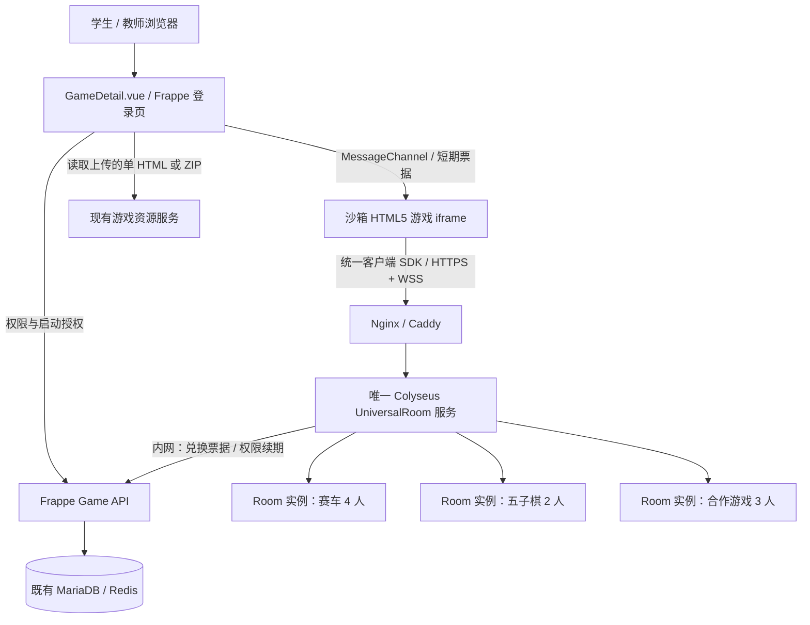

# Game 平台接入 Colyseus 通用 Room 联机方案（重构版）

**日期**：2026-10-17
**状态**：设计方案，未实施、未部署
**依据**：原《Game 接入 Colyseus 联机服务方案》（基于 `52ef3a2` 的工作区描述）；本文对其**架构决策作出替换**，不声称已经修改或验证仓库代码。

> **核心决策**：整个平台部署**一套固定的 Colyseus 服务，只注册一种通用 Room 类型**（如 `universal`）。它可以同时创建许多互相隔离的 Room 实例。新游戏仅上传前端 HTML/ZIP、填写或生成前端 manifest，并按统一 SDK 接入；**不交付游戏服务端代码、不构建新的游戏 Docker 镜像、不改 Colyseus 业务代码、不重启联机服务**。
>
> “不更新服务器”指**新增合规游戏时零服务端改动**；不排除为安全修复、Colyseus 升级、协议升级、扩容等进行平台维护。

---

## 1. 项目目标与非目标

### 1.1 目标

1. 将 Frappe LMS 作为唯一游戏目录、教师管理、课程解锁、访问权限与游戏资源入口；保留既有单机 HTML/ZIP 体验。
2. 开发并**仅部署一次**通用 Colyseus Relay Runtime；同一套服务支持五子棋、赛车、坦克、合作解谜等多种 HTML5 游戏。
3. 游戏按统一文档调用 `createRoom`、`joinRoom`、`quickMatch`、`send`、`onMessage`、`leave` 等 SDK 方法，自由建房、加入、邀请和通信。
4. 同一游戏可建多个房间；同一房间只允许**同站点 / 同游戏 / 同兼容版本 / 合法权限范围**的玩家加入。
5. 后续游戏发布只涉及**前端资源、Frappe 数据和配置**，不修改 Colyseus 服务，也不部署新的 Node 容器。
6. 小平台优先简单、稳定、资源低占用；依然保留登录权限、资源隔离及最低限度的滥用保护。

### 1.2 不做的事情

- Colyseus **不计算**游戏角色位置、物理碰撞、回合合法性、胜负、排行榜可信成绩；不为不同游戏编写专属 `Room`/`Schema`。
- 不做服务端权威同步、回滚预测、反作弊、防篡改战绩、跨房间共享游戏状态。
- 首期不做多节点 Colyseus、热迁移、断电后恢复正在进行的对局、复杂好友系统或复杂观战系统。
- **上传任意已有单机 HTML/ZIP 不会自动变成多人游戏**。需要开发者按统一接入文档，把房间和收发数据逻辑写在前端。

## 2. 与原方案的核心变化

| 项目 | 原方案 | 新方案 |
| --- | --- | --- |
| Colyseus Room | 每个游戏开发专属权威 Room | **仅一个 `UniversalRoom` 类型**，为各游戏创建多个实例 |
| 游戏运行时 | 每个 game/release 独立 Docker Runtime | **全平台仅一个通用 Runtime 容器**（初期） |
| 新游戏产物 | `client.zip` + 游戏服务端镜像 + manifest | **单 HTML 或 `client.zip` + 前端 manifest**（可表单生成） |
| 游戏规则 | Node 服务端执行与裁判 | **客户端或房主客户端执行** |
| 游戏消息 | 各游戏原生自定义 Room 消息 / Schema | 统一消息外壳；内部 `type/payload` 由各游戏定义 |
| 发布流水线 | 编译服务端镜像、拉起容器、分配路由 | 校验前端资源、登记版本、激活资源；**不操作 Docker** |
| Redis | 游戏 Presence/Driver + 授权存储 | **单实例匹配无需游戏 Redis**；短期票据可复用隔离命名空间的现有 Redis |
| 每增加一个游戏 | 新增 Room/镜像/部署 | **仅新增游戏前端包/配置** |
| 防作弊与权威战绩 | 依靠游戏服务端 | 不保证；成绩若记录需标注为**客户端上报、不可信** |

**精确定义**：“一套通用 Room”= **一个 Room 类/房间类型**；赛车 A 房、赛车 B 房、五子棋 C 房依然是互相隔离的**不同 Room 实例**。绝不把所有游戏玩家放进同一个实际房间。

## 3. 平台拓扑与服务职责



**Frappe 管理面（沿用原方案）**
- 游戏上传、版本、启用/停用、课程/课时解锁、教师试玩、学生访问控制、静态资源 token。
- 签发短期联机票据，绑定 LMS 用户与允许加入的游戏/版本/站点/范围；提供通用的房间请求授权。
- 在新游戏上传/激活后**只修改数据**，不重新编译平台代码。

**Colyseus 通用 Runtime（固定代码）**
- 仅提供 `universal` 这一种 Room 类型；管理玩家列表、房主/主持人、人数、房间可见性和生命周期。
- 进行房间创建、自动匹配、房间号加入、断线离开、简单重连与游戏消息转发。
- 仅验证**平台边界**：票据、站点/gameKey/compatibilityKey/scope 一致性、人数配额、消息大小与频率。
- **不解释、执行或校验具体游戏的 `payload` 规则**。

**游戏 HTML/JS（各游戏自行开发）**
- 实现游戏画面、输入、规则、游戏同步与最终结果展示。
- 简单回合制：交换玩家操作并由客户端计算。
- 实时赛车：建议由房主客户端计算与广播位置（约 10–20Hz 起步），其他客户端插值显示；允许自行改用输入同步。
- 房主退出后可按 SDK 的 `hostChanged` 事件执行自己的迁移策略；服务端不恢复游戏物理状态。

## 4. 通用 Room 的固定协议

### 4.1 房间隔离键

平台对每个房间固定以下标识：

- `site`：所属站点；从已验证的 Frappe 启动凭证确定。
- `gameKey`：游戏稳定 ID；从 `LMS Game` 后台确定，不信任客户端任意填入。
- `compatibilityKey`：兼容联机协议标识，默认 `release`，不同游戏版本默认不混房；兼容版本可显式使用相同组。
- `scope`：默认站点范围，如未来启用班级限制则来自 Frappe 权限计算。
- `mode`：例如 `private` / `public`；房间可见性由服务端设置。
- `maxPlayers`：从该游戏已发布 manifest 的范围内取值，由服务端实际设置 Colyseus `maxClients`。

**关键约束**：`.filterBy()` 只处理自动匹配；通过房间 ID 的 `joinById()` **必须再次检查**上述隔离键与权限，不得因知道房间号就越权。私人房间 ID 或邀请码不是身份认证凭证。

### 4.2 客户端 SDK 对外接口（拟议平台契约，非已有实现）

```ts
const net = await GamePlatform.connect(); // 从 iframe 父页获取短期授权

const room = await net.createRoom({ maxPlayers: 4, visibility: "private" });
// 或：await net.quickMatch({ maxPlayers: 4 });
// 或：await net.joinRoom({ roomCode: "AB12CD" });

room.on("playerJoined", ({ playerId }) => {});
room.on("playerLeft", ({ playerId }) => {});
room.on("hostChanged", ({ hostId }) => {});
room.on("message", ({ from, type, payload }) => {});
room.on("disconnected", () => {});

room.send("car:update", { x: 100, y: 200, angle: 1.57 });
await room.leave();
```

**说明**：上述 `GamePlatform` 是**拟开发的通用前端 SDK**；底层使用 `@colyseus/sdk`。对外只承诺这份长期稳定的接口，新游戏无需了解 Colyseus 内部 `Room` 生命周期与 Frappe 鉴权逻辑。SDK 版本应固定为 `platformApi: 1`，后续只做兼容性维护。

### 4.3 通用游戏消息外壳

游戏调用 `room.send(type, payload)`；统一 SDK 将数据打包发送：

```json
{
  "protocol": 1,
  "type": "car:update",
  "payload": { "x": 100, "y": 200, "angle": 1.57 },
  "seq": 103
}
```

接收端看到：

```json
{
  "from": "session-abc",
  "type": "car:update",
  "payload": { "x": 100, "y": 200, "angle": 1.57 },
  "seq": 103
}
```

- `from` **只能由服务器依据真实连接注入**，忽略上传消息中伪造的发送者身份。
- `type` 和 `payload` 都是**游戏自定义数据**：赛车用 `car:update`，五子棋用 `piece:place`，无须在服务端登记新事件名。
- 默认转发给同房其他玩家；如需回显给自己、发送给指定玩家或使用不同可靠性策略，必须在 **v1 SDK 首次开发时**统一定义，不随单个游戏改服务器。
- 保留 `platform:*` 为系统消息命名空间，游戏不得覆盖。
- 业务状态只存在客户端内存中；通用服务器不持有“赛车位置/棋盘/血量”的完整状态。

### 4.4 通用事件及职责

| 事件 / API | 平台保证 | 游戏自行处理 |
| --- | --- | --- |
| `createRoom` | 创建合法房间、返回 roomId/邀请码 | 设置本局初始规则 |
| `quickMatch` | 匹配同游戏、同兼容组、同范围、人数未满房间 | 准备开始时机 |
| `joinRoom` | 校验票据和目标 roomId 后入场 | 给新玩家发送当前状态快照 |
| `playerJoined/Left` | 通知玩家增减 | 角色出生/退出、对局暂停 |
| `hostChanged` | 通知新主持人 ID | 游戏状态迁移或主动结束对局 |
| `send/onMessage` | 通用消息转发 | 字段含义、验证、插值、冲突处理 |
| `leave/reconnect` | 连接生命周期与有限重连 | 恢复自己的游戏状态 |
| `roomClosed` | 通知房间不可用 | 返回游戏大厅 |

### 4.5 首期通用限制（平台配置，不是游戏规则）

- 单房间建议 `2–4` 人，平台可配置最大 `8` 人；游戏发布时设置的值不得高于平台上限。
- 单条消息示例限制 `16 KiB`，单连接示例限制 `30–60` 条/秒；具体阈值通过赛车/五子棋压测后确定，超过时限流或断连。
- 不转发文件、贴图、音频或视频流；资源文件由原静态资源服务加载。
- 单用户同时建房数、总连接数、空房释放超时、房间最长寿命都由通用 Runtime 统一限制。
- 首期不依赖 Redis 实现 Colyseus 多进程匹配，避免不必要的进程路由复杂性。

## 5. 游戏上传与 manifest：只需要前端

### 5.1 允许两种上传模式

1. **单 HTML**：游戏 JS、SDK 可以通过构建打包在同一个 HTML 文件中；需保留现有 CSP 的联机白名单路径。
2. **ZIP 游戏包**：包含 `index.html`、JS、CSS、素材、已构建的 SDK；复用 `game_package.py` 的资源鉴权。

**不接受**游戏服务端目录、游戏的 Node.js 启动命令、OCI 镜像、任意 Docker Compose 或任意自定义外网连接 URL。上传资源仍按现有安全边界处理。

### 5.2 新的 manifest 示例

以下字段是**新平台拟制定格式，不是 Colyseus 官方格式**：

```json
{
  "manifestVersion": 1,
  "gameKey": "road-king",
  "release": "1.0.0",
  "platformApi": "1",
  "client": {
    "entry": "index.html",
    "type": "zip"
  },
  "multiplayer": {
    "enabled": true,
    "mode": "relay",
    "compatibilityKey": "road-king-net-v1",
    "minPlayers": 2,
    "maxPlayers": 4,
    "allowPrivateRoom": true,
    "allowQuickMatch": true
  }
}
```

`gameKey` 必须与 Frappe 所属游戏记录一致；`release` 和兼容组经后台校验。上传 UI 可以根据选项**自动生成 manifest**，不强迫教师手动编写 JSON。离线单机游戏 `multiplayer.enabled=false` 或省略该段。

### 5.3 后续发布流程（无需服务器更新）

1. 开发者依据《HTML5 游戏通用联机接入文档》完成游戏前端代码。
2. 本地使用通用 SDK 连接开发环境，测试两人/四人加入同一房间。
3. 上传单 HTML 或 ZIP；填写名称、版本、最大人数、是否公开匹配等配置。
4. Frappe 检查资源、安全设置、manifest 结构、SDK 版本兼容性，登记 `LMS Game Release`。
5. 教师启用/课程绑定，平台切换 `active_release`；新游戏使用已有通用 Runtime 直接联机。
6. 需要升级游戏时只上传新前端发行版本，**原 Colyseus 容器无变化**。旧版本对局可以按原资源和兼容组自然结束。

## 6. LMS 启动、权限与沙箱（保留原设计的关键边界）

既有仓库约束：

| 现有文件 | 保留与调整 |
| --- | --- |
| `lms/lms/game.py` | 保留上传/读取/教师管理和 `require_access(name)` |
| `lms/lms/game_access.py` | 继续作为课程解锁及个人放行/禁止的**唯一权限来源** |
| `frontend/src/pages/GameDetail.vue` | 保持 `sandbox="allow-scripts allow-pointer-lock"`，加入固定的联机启动桥接 |
| `frontend/src/utils/game.ts` | 单 HTML 联机时允许平台**固定** HTTPS/WSS 端点；单机保持 `connect-src 'none'` |
| `lms/lms/game_package.py` | 保留 ZIP token、专用 Cookie、资源访问校验；适配不可变版本路径及 CSP |
| `docs/game.md` | 记录旧 SDK 已移除；本次新建固定 SDK，不复用已移除接口 |
| `docker/redeploy.sh` | 避开旧 `realtime/`、`packages/game-sdk` 等会被删除的路径 |

### 6.1 标准启动链路

1. 学生在 `GameDetail` 打开已获权限的游戏，父页用 LMS 会话请求 `create_launch(game)`。
2. Frappe 使用已有访问检查固定 `(site, user, gameKey, release, compatibilityKey, scope)`。
3. 沙箱 iframe 发出带随机 nonce 的 READY；父页验证 `event.source`、当前加载代次，再建立 `MessageChannel`。
4. 游戏 SDK 请求 `createRoom/quickMatch/joinRoom`，父页按需向 Frappe 申请约 60 秒有效、一次性的短期票据。
5. 通用 Runtime 通过受保护内网接口原子兑换票据、检查目标房间范围与人数，随后完成 Colyseus 匹配和 WSS 连接。
6. 同房玩家使用统一消息协议转发业务消息。**每帧游戏消息不经过 Frappe/Python**。
7. 关闭页面、退出游戏、教师撤权时按平台统一策略关闭连接；异常断网由重连窗口或新启动处理。

### 6.2 必须坚持的安全边界

- **资源票据与联机票据分离**；不将 Frappe 登录 Cookie/SID 暴露给沙箱内游戏 JS。
- iframe 保持 opaque origin（`Origin: null`），不增加 `allow-same-origin`；握手限定实际 iframe Window、nonce、MessageChannel 的生命周期。
- 只允许固定的游戏联机 HTTPS/WSS 域名；不接受上传文件提供任意 `connect-src` 白名单。
- 浏览器来源为 `null` 并不能证明身份；匹配 API 仍需票据，WSS 入房仍需座位验证。
- 即使是小平台、不要反作弊，也**不能跳过权限验证、跨游戏隔离、消息限流**。
- 联机授权的持续有效性可沿用原方案的周期租约（如约 30–60 秒）及权限撤销通知，避免学生游戏已被禁用却一直连接。租约刷新不逐帧请求 Frappe。
- ZIP 资源 Cookie 在第三方 Cookie 受限浏览器中的行为仍需分别测试；新联机票据不能修复旧资源 Cookie 的浏览器限制。

## 7. Frappe 数据结构与 API 简化

### 7.1 建议数据模型

| 模型 | 核心字段 | 与原方案相比 |
| --- | --- | --- |
| `LMS Game` | `runtime_mode=Static/UniversalRelay`、封面、开关、`active_release` | 不再指向各游戏服务端部署 |
| `LMS Game Release` | `gameKey`、版本、前端文件、入口、SDK 版本、manifest、资源 hash、激活状态 | **移除服务端镜像 digest/Runtime profile** |
| `LMS Game Session`（可选） | 房间号、游戏、参与者、开始/结束、客户端结果标记 | 不存每帧位置；结果非权威 |
| `Universal Runtime Config` | 唯一联机 WSS 地址、协议版本、上限、健康状态 | 全平台一份，不随游戏增加 |
| 临时票据/租约 | 用户会话引用、game/release/scope、到期和一次性消费状态 | 复用现有 Redis 合理隔离 key 命名空间 |

无需“每个游戏发行版本一个 `LMS Game Deployment`”。如需保留这个 DocType，仅维护通用服务部署记录，不为每个游戏生成部署实例。

### 7.2 固定 API

| API | 用途 |
| --- | --- |
| `create_launch(game)` | 检查游戏权限，返回版本资源与固定联机端点 |
| `issue_join_ticket(launch_id, action, room_id?)` | 用于创建/匹配/加入的短期票据，绑定目标操作及目标房间（若有） |
| `close_launch(launch_id)` | 结束启动上下文 |
| 内网 `redeem_ticket` | Runtime 原子验证票据和可信的游戏/版本/范围/人数设置 |
| 内网 `renew_leases` | 撤权与会话有效性确认 |
| `publish_release / activate_release` | 只更新 Frappe 前端资源与版本数据，不部署游戏服务 |

提供给游戏开发者的接口**只有通用 JS SDK**，无需暴露以上 Frappe 内网接口细节。

## 8. Docker / 运维：一套服务永久复用

首期在同一台 VPS 上部署：

```text
Frappe + MariaDB + 已有 Redis（原系统）
            |
       Nginx / Caddy 443
            |
  game-universal-runtime:2567
      (Colyseus + UniversalRoom)
```

- 运行**一个** `game-universal-runtime` Docker 服务，固定 Colyseus 版本和锁文件。上传游戏不会触发容器镜像构建。
- 单实例 Colyseus 本地房间匹配即可；不需要为不同游戏新增端口或子域名。
- 不强制新建一套游戏 Redis；现有 Redis 若用于票据，应使用受控密钥/命名空间与 TTL，避免与 Frappe 业务 key 冲突。
- 通过 Nginx/Caddy 提供 HTTPS/WSS 与 WebSocket Upgrade；Colyseus 私有端口不直接暴露公网。
- 日志记录 `site/gameKey/release/roomId/sessionId`、连接数量、转发次数和网络错误；**不记录敏感 token 或完整游戏 payload**。
- 更新基础联机服务属于平台版本升级，应在无活跃房间窗口进行；以后增加游戏**不需要重启**。

### 8.1 性能与容量边界

该架构的 CPU 压力小于运行赛车物理模拟的权威服务器，但**所有消息仍经过 Colyseus 中继**，因此不是 P2P 零带宽转发。带宽近似与房间人数、消息大小、频率和广播接收人数成正比。

示例：一个四人房间，每位玩家每秒发送 20 条、每条业务数据 60B（未计网络开销），若每条发给其余三人：

- 业务上行：`4 × 20 × 60 = 4,800 B/s`。
- 业务下行：`4 × 20 × 60 × 3 = 14,400 B/s`。
- 业务负载合计约 `0.154 Mbps`，**加上 WebSocket/TCP/IP/TLS 与额外协议开销后实际会更高**。

单机首期按少数房间部署；上线前用 2、4、8 人等场景压测，并依据实际出站带宽升级 VPS。这里不承诺固定 CCU。

## 9. 新增游戏时必须遵循的规则

1. 游戏必须使用平台提供的 **v1 SDK**，不自行连接其他 WebSocket 后端。
2. `gameKey`、玩家身份、所属课程、许可范围由平台授予，不能由游戏自己声称。
3. Room 最大人数、公开/私人匹配模式在 manifest 中声明，平台统一限额。
4. 需要向新玩家同步正在进行的游戏时，游戏需要实现**快照发送**；服务器不会保存棋盘、赛车位置等业务状态。
5. 房主退出需要游戏自己决定：切换主机、暂停、重开或终止。
6. 游戏消息 `type` 仅在游戏内部约定，不需要向 Colyseus 注册类型；避免使用保留的 `platform:*` 命名空间。
7. 游戏不能把客户端发来的数据当作可信成绩。若平台记录“完成/得分”，仅作为**非权威学习互动记录**。
8. 前端资源升级后默认不同 `release` 不能混房；如确实网络协议兼容，才能使用同一个 `compatibilityKey`。

## 10. 实施步骤与验收

### 第一阶段：一次性搭建通用 Runtime

- 建立 `UniversalRoom`：玩家列表、主持人、动态 `maxClients`、消息中继、Room 生命周期、房间隔离。
- 固定一个通用 Room 类型名，如 `universal`，不注册 `racing`、`gomoku` 等游戏专属房间。
- 建立 Frappe 票据验证适配与统一匹配入口；全部 join 路径，包括 `joinById`，都验证目标游戏和权限范围。
- 部署唯一 Docker 容器、Nginx HTTPS/WSS、健康检查和基本限流。

**验收**：赛车 A 与五子棋 B 同时建房、分别通信且互不串线；同一游戏多房并行；错误版本、未解锁账号、错误房号、满房均拒绝；进程日志只有一个 Room 类型。

### 第二阶段：一次性改造 LMS 与发布

- 加 `UniversalRelay` 运行模式、前端 manifest/版本字段、`create_launch`、短期票据和租约。
- 实现 `GameDetail.vue` 的 iframe → MessageChannel 启动桥接。
- 适配单 HTML / ZIP 两种 CSP 路径、固定 WSS 白名单和不可变资源版本。
- 上传/激活流程只处理前端产物，不接受服务端镜像和启动命令。

**验收**：教师上传新游戏后可直接进入联机，不触发 Docker 构建与重启；旧单机游戏继续工作，原教师试玩和课程解锁规则不回归。

### 第三阶段：交付统一 SDK 与开发者文档

- 完成 v1 SDK：`connect/createRoom/quickMatch/joinRoom/send/on/leave`、玩家与主持人事件、连接失败提示。
- 发布一份统一《HTML5 游戏通用联机接入文档》，提供 HTML 单文件模板、ZIP 模板、五子棋双人示例、四人赛车位置同步示例。
- 提供开发测试模式，使开发者在本地前端调试，但生产游戏仍必须经过 LMS 授权。

**验收**：两款未在 Runtime 写死名字的新游戏，仅遵循 SDK 文档开发并上传后同时联机；发布前后 Colyseus Docker **镜像 digest、启动时间、Room 类型定义均不变**。

### 第四阶段：稳定性与小规模压测

- 测试同房 2/4/8 人、跨游戏隔离、频繁创建/退出、浏览器刷新、房主退出、断线、教师撤权、空房回收。
- 记录实际流量、CPU/内存、消息频率与平均延迟；配置统一限额。
- 故障时允许对局终止，不承诺自动恢复；向用户给出明确断线/重试提示。

## 11. 预计仓库修改位置（一次性）

| 路径 | 新方案修改 |
| --- | --- |
| `lms/lms/game.py` | 返回静态/通用联机模式，沿用访问入口 |
| `lms/lms/game_runtime.py`（新增） | 固定联机 launch/ticket/lease API |
| `lms/lms/game_access.py`、`lms/hooks.py` | 权限复核、撤销事件（保留原约束） |
| `lms/lms/game_package.py` | 版本资源与受控 CSP/WSS 连接策略 |
| `lms/lms/doctype/` | Game / Release 数据字段，**不增加每游戏独立 Runtime 部署结构** |
| `frontend/src/pages/GameDetail.vue` | 固定父子页启动桥接与错误界面 |
| `frontend/src/utils/game.ts` | 单 HTML 受控联机 CSP |
| `packages/game-platform-client/`（新增） | **通用前端 SDK，一次开发，所有游戏使用** |
| `services/game-runtime/`（新增） | **唯一 UniversalRoom** + 匹配/票据验证/转发/限流 |
| `games/colyseus-demo/`（新增） | 双人、四人客户端示例；**没有游戏专属服务端** |
| `docker/docker-compose.yml` / 代理配置 | **增加一个通用 Colyseus 容器** |
| `docs/game-multiplayer-sdk.md`（新增） | 开发者统一接入规范 |
| 测试文件 | 权限、串房、各 join 路径、CSP、SDK 版本与零服务器更新验收 |

请先检查当前工作区的未提交修改，以增量方式实现；不要覆盖原 Game 页面、上传与权限变更。原文提到 `docker/redeploy.sh` 会删除旧 `realtime/`、`packages/game-sdk`，新代码应继续避开这些路径。

## 12. 成功标准与最终结论

**最重要的一条验收测试**：

> 部署通用 Colyseus 一次后，先上线五子棋，再上传此前从未注册过的赛车 HTML/ZIP；赛车自行创建四人房间并成功联机。**整个过程中不修改 `services/game-runtime/`、不新增游戏专属 Room、不构建/重启 Colyseus 容器、不增加代理路由**。

其他必要验收：不同游戏不会串房；不同版本默认不会混房；单 HTML/ZIP 都能打开；Frappe 解锁/禁止有效；私房邀请码不能越过身份验证；旧静态游戏不受影响。

**最终推荐**：保留原方案“Frappe 管理权限与前端资源”的基础，**删除“每游戏权威 Room、独立服务端镜像和 Docker 发布流水线”的设计**，改成**一个长期运行的通用中继 Room + 通用 JS SDK + 前端上传发布**。在“小规模、不要求反作弊、优先后续游戏零后端改动”的目标下，这更符合需求。

---

## 13. 参考资料

- 原文件：《Game 接入 Colyseus 联机服务方案》（2026-10-17，未实施版本）。
- Colyseus 官方 Relay Room：https://docs.colyseus.io/room/relay
- Colyseus 官方 Matchmaking / `filterBy`：https://docs.colyseus.io/matchmaker
- Colyseus 官方私有房间和 `joinById` 说明：https://docs.colyseus.io/matchmaker/visibility
- Colyseus 官方 Room Authentication：https://docs.colyseus.io/auth/room

**待验证**：官方 Colyseus 版本锁定后需进行 API 实测，特别是服务端动态人数、匹配入口的鉴权执行顺序、SDK 回调、重连与私房加入。本文 SDK 名称、manifest 字段、接口、租约与限流数字均为拟议平台规范，而非已完成的仓库代码。
